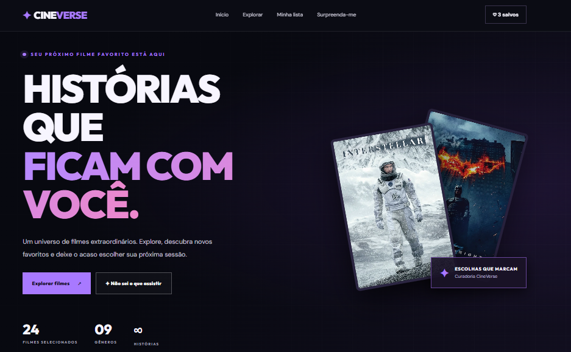
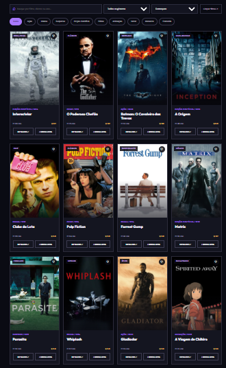
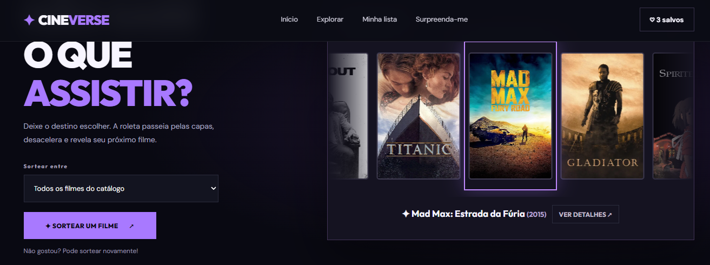
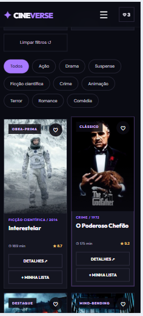

# 🎬 CineVerse — Descubra seu próximo filme

CineVerse é uma plataforma demonstrativa de descoberta de filmes, desenvolvida com HTML, CSS e JavaScript.

O projeto apresenta um catálogo interativo de filmes, permitindo pesquisar títulos, aplicar filtros, consultar detalhes, salvar filmes em uma lista pessoal e utilizar uma roleta animada para escolher o que assistir.

## 🌐 Projeto online

Acesse o projeto publicado:

https://jefersonalvesrs.github.io/CineVerse/

## 🖼️ Preview

### Página inicial

### Catálogo de filmes

### Roleta de filmes

### Versão mobile

## ✨ Funcionalidades

- Catálogo interativo com 24 filmes
- Pesquisa por título, diretor ou ano
- Filtros por gênero
- Ordenação dos filmes
- Janelas com informações detalhadas
- Lista pessoal de filmes para assistir
- Sistema de favoritos com contador
- Armazenamento da lista no navegador
- Roleta animada com desaceleração para sortear filmes
- Sorteio entre todos os filmes ou apenas os salvos
- Interface responsiva para desktop e celular
- Menu de navegação adaptado para dispositivos móveis

## 🛠️ Tecnologias utilizadas

- HTML5
- CSS3
- JavaScript
- Git
- GitHub
- GitHub Pages (para publicação)

## 📱 Responsividade

O CineVerse possui uma interface adaptável a diferentes tamanhos de tela, com ajustes no catálogo, na navegação e nos componentes interativos para proporcionar uma boa experiência em computadores e smartphones.

## 💡 O que pratiquei neste projeto

- Estruturação de páginas com HTML
- Estilização e responsividade com CSS
- Manipulação do DOM com JavaScript
- Manipulação de arrays e objetos
- Busca, filtragem e ordenação de dados
- Eventos e interações do usuário
- Armazenamento local com JavaScript
- Animações e transições
- Desenvolvimento de interfaces interativas
- Versionamento com Git

## 📌 Sobre o projeto

O CineVerse é um projeto demonstrativo desenvolvido para fins de estudo e portfólio. Não possui integração com serviços de streaming nem oferece reprodução de filmes.

Esta versão apresenta algumas funcionalidades que poderão servir de referência para o desenvolvimento futuro de uma plataforma mais completa.
